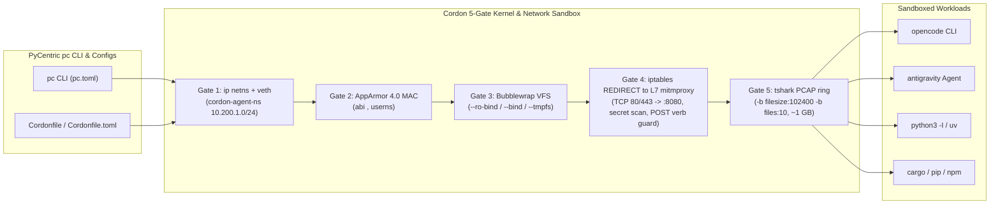

# Cordon (`pycentric-cordon`) - Type-Safe Rust & Dual-Stack Edition

> [!NOTE]
> **Open core model in one line:** the engine is AGPL-3.0-only; supported enterprise packages and internal governance docs are proprietary.
> **Open core licensing.** The Cordon engine is free and open source software under the **GNU Affero General Public License v3 only** (`AGPL-3.0-only`, see [`LICENSE`](LICENSE)). Internal governance/commercial/legal documents, the PyCentric `pc` orchestrator integration, and PyCentric-branded distribution packages (`pycentric-cordon` `.deb`/`.rpm`/tarball/wheel/Flatpak builds) remain proprietary to PyCentric (Pty) Ltd and are **not** covered by the AGPL grant. See [`NOTICE.md`](NOTICE.md) for the full scope map and [`LICENSE-PYCENTRIC.md`](LICENSE-PYCENTRIC.md) for the proprietary terms. "PyCentric", "Cordon", and `pycentric-cordon` are trade marks of PyCentric (Pty) Ltd; no trade mark rights are granted.

**Security-tool evaluators:** Cordon blocks pre-sandbox interpreter hijacking, unsafe root/`$HOME` read-write mounts, in-workspace `.git` hook tampering, and secret or mutating-verb egress to package registries (details in Key Security Invariants below). Run `cordon doctor` (15-point host attestation report; machine-readable via `cordon --json doctor` or `GET /api/v1/doctor`) and read the [Security Threat Model & Disclosure Policy (`SECURITY.md`)](SECURITY.md).

**Cordon: zero-unsafe Rust Linux execution sandbox with a reproducible Cordonfile engine and L3-L7 network inspection (netns, AppArmor, bubblewrap, L7 egress policy, PCAP). AGPL-3.0-only.**  
*Engineered and Governed by PyCentric (`ADR-L0-SEC-02` | [Operations & Workload Guide](docs/OPERATIONS_AND_WORKLOAD_GUIDE.md))*

---

## 1. Overview

**Cordon** is a lightweight, zero-unsafe (`#![forbid(unsafe_code)]`), type-safe Rust security perimeter and network telemetry control plane for Linux (`>= 5.15` / `6.8+`). Originally designed to contain semi-trusted local AI CLI coding agents (`opencode`, `antigravity`, `claude`, `aider`), Cordon generalizes the **5-gate kernel isolation pipeline** to run **any software or code** directly against host workspaces without Docker container bloat or UID/GID remapping friction:

$$\text{Host Shell / Cordonfile} \rightarrow \text{Gate 1: ip netns} \rightarrow \text{Gate 2: AppArmor 4.0 MAC} \rightarrow \text{Gate 3: Bubblewrap VFS} \rightarrow \text{Gate 4: L7 mitmproxy} \rightarrow \text{Gate 5: tshark PCAP}$$



### Key Security Invariants (`ADR-L0-SEC-02`)
- **Zero Pre-Sandbox Interpreter Hijacking**: Compiled to a standalone native ELF binary (startup latency is canonical metric `M1`; the `M1`-`M4` metric definitions are defined in internal governance (not published)), eliminating `PYTHONPATH` or `.pth` injection vectors before namespace entry.
- **Reproducible `Cordonfile` & `Cordonfile.toml` Environments**: Define shareable, version-controlled sandbox environments (`FROM`, `WORKDIR`, `MOUNT`, `MASK`, `MASK_DIR`, `ALLOW_DOMAIN`, `DENY_DOMAIN`, `ENV`, `CMD`) just like a `Dockerfile` or `Containerfile`, without container image bloat.
- **Compile-Time Typestate Invariants**: `CanonicalPath` guarantees physical `realpath` resolution before a `SandboxLaunchPlan` can be constructed (`FR-1.2`), and refuses to mount `/` or `$HOME` read-write on both `--workspace` and `-v <path>:rw` / `--bind-rw` mounts (`CordonError::UnsafeWorkspaceMount`, HTTP `422`).
- **Repository `.git` Tamper Protection (`EC-01`)**: Automatically overlays `--ro-bind-try <workspace>/.git <workspace>/.git` inside read-write workspaces so confined agents cannot poison `.git/hooks`.
- **Mutating HTTP Method & Secret Egress Guard (`FR-5.4` & `UC-02`)**: Permits `POST` to approved LLM inference APIs while blocking `POST`/`PUT`/`PATCH`/`DELETE` exfiltration to read-only package registries (`pypi.org`, `crates.io`, `registry.npmjs.org`) and scanning payloads against 6 high-precision secret signature families (`SECRET_GITHUB_PAT`, `SECRET_OPENAI_KEY`, `SECRET_AWS_ACCESS_KEY`, `SECRET_PRIVATE_KEY_PEM`, `SECRET_JWT_BEARER`, `SECRET_ENV_ASSIGNMENT`), with fine-grained `github_pat_...` and AWS `ASIA...` temporary key formats.
- **Strict Memory & Panic Safety**: Enforces `#![forbid(unsafe_code)]` and `#![deny(clippy::unwrap_used, clippy::expect_used)]` across all Rust library and binary targets (`>= 90%` LLVM line coverage target; CI enforces the measured baseline floor).

---

## 2. Six Universal Workload Profiles

| Profile | Workload Kind | Filesystem Mode | Network Mode | `.git` RO Guard | Target Use Case |
| :--- | :--- | :--- | :--- | :--- | :--- |
| **`ai-agent`** | `AiAgent` | `WorkspaceRw` | `Inspected` | `true` | Local AI CLI coding agents (`opencode`, `antigravity`, `claude`, `aider`) |
| **`untrusted-code`** | `UntrustedCode` | `WorkspaceRo` | `None` | `true` | Arbitrary untrusted scripts (`python3 -I`, `uv`), CTF binaries, and downloaded tools |
| **`package-build`** | `PackageBuild` | `WorkspaceRw` | `AllowlistOnly` | `true` | Supply-chain builds (`npm install`, `pip install`, `cargo build`) |
| **`network-audit`** | `NetworkAudit` | `WorkspaceRo` | `Inspected` | `true` | Closed-source binary telemetry auditing (`tshark` PCAP + `mitmproxy`) |
| **`gui-desktop`** | `GuiDesktop` | `WorkspaceRo` | `Inspected` | `true` | Sandboxed Wayland GUI apps with GPU `/dev/dri` and X11 keylogger block |
| **`airgapped`** | `Airgapped` | `StrictRo` | `None` | `true` | Offline cryptographic key ceremonies and deterministic batch jobs |

---

## 3. PyCentric `pc` CLI Orchestrator (`pc.toml`)

Cordon adopts the **PyCentric `pc` CLI** (installed on `PATH`) via [`pc.toml`](pc.toml) and [`Taskfile.yml`](Taskfile.yml):

```bash
# Verify developer workstation & polyglot toolchains (Rust, Flutter, go-task)
pc doctor

# Build optimized release artifacts
pc build --release

# Run static analysis (cargo clippy -D warnings, flutter analyze) and format checks
pc lint
pc fmt --check

# Run tiered test suites (fast | integration | contract | stress | all)
pc test --mode fast
pc test --mode integration
pc test --mode contract
pc test --coverage

# Package redistributable bundles (.deb, .rpm, AppImage, Flatpak) or install system-wide
pc package deb
pc install
```

---

## 4. Reproducible Configs (`Cordonfile`) & Workload Recipes

See the complete **[Operations, Workload Execution & Packaging Guide (`docs/OPERATIONS_AND_WORKLOAD_GUIDE.md`)](docs/OPERATIONS_AND_WORKLOAD_GUIDE.md)** for architectural diagrams and deep-dive recipes.

### 4.1 Managing Reproducible Environment Templates
```bash
# List built-in starter templates (opencode, antigravity, python-sandbox, package-build)
cordon config list-templates

# Initialize a Cordonfile or Cordonfile.toml in your project
cordon config init --template opencode --format cordonfile --output ./Cordonfile
cordon config init --template antigravity --format toml --output ./Cordonfile.toml

# Validate a config file and inspect the resolved 5-gate profile
cordon config validate --file configs/Cordonfile.opencode
```

### 4.2 Running `opencode`, `antigravity`, and Python Code + Mounting Host Folders
```bash
# 1. Run OpenCode CLI with a read-only reference repo mount and writable workspace
cordon run -f configs/Cordonfile.opencode \
  -w ~/projects/cordon \
  -v ~/projects/shared-docs:ro \
  -e ANTHROPIC_API_KEY="${ANTHROPIC_API_KEY:-}" \
  --dry-run -- opencode

# 2. Run Antigravity coding assistant with brain artifact directory mounted read-write
cordon run -f configs/Cordonfile.antigravity \
  -w ~/projects/cordon \
  -v ~/.gemini/antigravity/brain:rw \
  -v ~/.gemini/config:ro \
  --dry-run -- bash --norc

# 3. Run untrusted Python / uv code in a zero-network air-gapped sandbox with a dataset mounted read-only
cordon run -f configs/Cordonfile.python \
  -w ~/projects/cordon \
  -v /tmp/datasets:ro \
  -v /tmp/output:rw \
  --dry-run -- python3 -I script.py

# 4. Run isolated package builds (cargo / pip / npm) with registry-only L7 egress
cordon run -f configs/package-build.cordon.toml \
  -w ~/projects/cordon \
  --dry-run -- cargo build --release

# 5. Execute a Cordonfile directly like a shell script (via #!/usr/bin/env -S cordon run -f)
./configs/Cordonfile.antigravity
./configs/Cordonfile.opencode
```

### 4.3 Exposing Specific Host Programs (`bat`, `ripgrep`) & Pre-Populated Command/Directory Groups
When running `antigravity`, `opencode`, or an interactive shell, you can expose specific host tools (even if installed in `~/.cargo/bin` or `~/.local/bin` or masked by a strict profile) individually or via pre-populated groups:

```bash
# Inspect all 8 pre-populated command groups and 6 filesystem directory groups
cordon groups

# Expose bat and ripgrep (rg) + mount XDG tool configs from the CLI
cordon run --allow-bin bat --allow-bin rg --allow-group search-tools --mount-group xdg-config \
  -f configs/Cordonfile.antigravity

# Or inside the interactive Cordon REPL (cordon repl):
#   cordon[ai-agent]> allow-bin bat rg fd jq
#   cordon[ai-agent]> allow-group coreutils shell-builtins search-tools vcs-git
#   cordon[ai-agent]> mount-group xdg-config agent-state
#   cordon[ai-agent]> ./configs/Cordonfile.antigravity
```

- **8 Pre-Populated Command Groups (`allow-group` / `--allow-group` / `ALLOW_GROUP`)**:
  `coreutils`, `shell-builtins`, `search-tools` (`rg`, `ripgrep`, `bat`, `fd`, `fzf`, `jq`, `yq`, `grep`, `find`, `sed`, `awk`, `tree`), `vcs-git`, `rust-toolchain`, `python-uv`, `node-web`, `net-diag`.
- **6 Pre-Populated Filesystem Directory Groups (`mount-group` / `--mount-group` / `MOUNT_GROUP`)**:
  `system-libs` (`:ro`), `ssl-certs` (`:ro`), `xdg-config` (`:ro`), `agent-state` (`:rw`), `toolchain-caches` (`:ro`), `temp-scratch` (`:rw`).

### 4.4 Interactive Sandbox REPL (`cordon repl`), Keyboard Shortcuts & Tmux-Style Plugin Ecosystem
`cordon repl` features a raw-mode `crossterm` line editor ([`src/repl_editor.rs`](src/repl_editor.rs)) with live ANSI syntax highlighting, persistent history (`~/.local/share/cordon/repl_history` or `$CORDON_HISTFILE`), and a tmux-inspired plugin ecosystem ([`src/plugins.rs`](src/plugins.rs), [`plugins/`](plugins)):

| Shortcut / Command | Action |
| :--- | :--- |
| `Up` / `Down` (`Ctrl-P` / `Ctrl-N`) | Navigate persistent command history |
| `Ctrl-R` | Incremental reverse-i-search through command history |
| `Right` / `Ctrl-F` / `End` | Accept Fish-style inline ghost autosuggestion |
| `Tab` | Contextual completion for commands, `./configs/*`, groups, and plugins |
| `Ctrl-U` / `Ctrl-K` / `Ctrl-W` | Kill line before cursor / kill to end of line / delete previous word |
| `Ctrl-A` / `Ctrl-E` / `Ctrl-L` | Move to start of line / end of line / clear terminal screen |
| `ls [configs\|mounts\|bins\|groups\|plugins]` | Shorthand to list executable `Cordonfile`s, mounts, binaries, groups, or plugins |
| `./<Cordonfile\|script>` | Load and execute a `Cordonfile` or workspace script directly |
| `set -g @plugin 'cordon-plugins/<name>'` | Tmux-style directive to load `cordon-fish` or `cordon-hud` |

- **Built-in First-Party Plugins (`cordon plugin list` / `cordon plugin info <name>`)**:
  - [`plugins/cordon-fish/plugin.toml`](plugins/cordon-fish/plugin.toml): Fish-shell inline ghost autosuggestions, live token syntax coloring (valid commands in bold green, unknown in bold red, flags in cyan, strings in yellow, groups in bold magenta, existing paths underlined in blue), and abbreviated `prompt_pwd` (`~/P/cordon`).
  - [`plugins/cordon-hud/plugin.toml`](plugins/cordon-hud/plugin.toml): Tactical Heads-Up Display (HUD) multi-segment telemetry prompt (`cordon[profile|git:branch|net:mode|~/P/cordon]> `), preloaded `search-tools` + `xdg-config` groups, and curated aliases (`ag`, `oc`, `py`, `bat-rg`, `ll`, `lm`, `lb`, `lg`, `lp`, `airgap`, `hostnet`).

---

### 4.5 Optional Gate 3.5: KVM MicroVM Isolation (preview)

For workloads where a host-kernel exploit is in scope (binary detonation, fuzzing, untrusted root), Cordon can run the workload under a dedicated guest kernel. The VMM itself runs **inside** Gates 1-3, so guest traffic still passes through the L7 policy and PCAP gates, and live-workspace guests inherit the read-only `.git` protection. Two engines are planned: QEMU `-M microvm` (live workspace over virtio-fs) and Firecracker (sealed block images, snapshot restore).

This release ships the compile-time plane: validation, `[vm]` / `VM_*` config, `--vm-*` flags, the `vm` field on `POST /api/v1/compile`, AppArmor (`render-apparmor --microvm`) and tap-pool (`render-netns --microvm`) rendering, and doctor probes. Review plans with `--dry-run` or `inspect-cmd`; live MicroVM launch exits with code 69 until the guest agent ships.

```bash
cordon run --dry-run -p untrusted-code -w /tmp/sample \
  --vm-backend firecracker \
  --vm-kernel /var/lib/cordon/kernels/vmlinux-microvm \
  --vm-rootfs /var/lib/cordon/images/alpine-audit.erofs -- ./sample
```

Design, threat model, and roadmap: [`docs/design/microvm-isolation.md`](docs/design/microvm-isolation.md).

## 5. Packaging, Distribution & Shell Completions (`dist/` & `packaging/`)

Cordon ships with a reproducible packaging pipeline ([`scripts/package-dist.sh`](scripts/package-dist.sh) and [`packaging/`](packaging)) supporting standalone Linux tarballs, Debian/Ubuntu `.deb`, Fedora/RHEL `.rpm`, `AppImage`, `Flatpak`, `systemd` service units, and native **Bash**, **Zsh**, and **Fish** shell completions ([`packaging/completions/`](packaging/completions)):

```bash
# Build dist/pycentric-cordon-1.0.0-linux-x86_64.tar.gz, dist/pycentric-cordon_1.0.0_amd64.deb, and dist/SHA256SUMS
go-task package:all

# Install Cordon binary, starter configs, and Bash/Zsh/Fish completions for current user
go-task install:local

# Or generate/source completions directly for Fish, Zsh, or Bash:
cordon completions fish --output ~/.config/fish/completions/cordon.fish
cordon completions zsh  --output ~/.zfunc/_cordon
cordon completions bash --output ~/.local/share/bash-completion/completions/cordon
```

---

## 6. Repository Architecture & Documentation Map

### 6.1 Core Rust Engine (`src/`)
- [`src/domain.rs`](src/domain.rs): Validated newtypes (`CanonicalPath`, `ZarCents`), exhaustive enums (`WorkloadKind`, `NetworkMode`, `FilesystemMode`, `Verdict`, `Severity`, `EnforcementPlane`), and serializable DTOs.
- [`src/config.rs`](src/config.rs): Reproducible environment parser (`CordonEnvironmentConfig`) supporting executable `Cordonfile`, `Cordonfile.toml`, `cordon.json`, `ALLOW_BIN`, `ALLOW_GROUP`, `MOUNT_GROUP`, `PLUGIN`, and `-v /path[:ro|:rw]` volume parsing.
- [`src/groups.rs`](src/groups.rs): Pre-populated command groups (`coreutils`, `shell-builtins`, `search-tools`, `vcs-git`, `rust-toolchain`, `python-uv`, `node-web`, `net-diag`), directory groups (`system-libs`, `ssl-certs`, `xdg-config`, `agent-state`, `toolchain-caches`, `temp-scratch`), and host `$PATH` binary resolver (`resolve_host_binary`).
- [`src/plugins.rs`](src/plugins.rs): Tmux-style plugin engine (`CordonPlugin`, `set -g @plugin`, `abbreviate_fish_path`, `detect_git_branch`) and manifests for `cordon-fish` and `cordon-hud`.
- [`src/repl.rs`](src/repl.rs) & [`src/repl_editor.rs`](src/repl_editor.rs): Interactive sandbox control REPL, `crossterm` raw-mode line editor (`Up`/`Down`, `Ctrl-R`, `Ctrl-U`, `Ctrl-W`, `Tab`), Fish ghost autosuggestions, live ANSI syntax highlighting, persistent `HistoryStore`, `./` executable config runner, and `ls` shorthand.
- [`src/error.rs`](src/error.rs): `thiserror` domain error hierarchy (`CordonError`) and RFC 7807 `Rfc7807ProblemDetails` (`application/problem+json`).
- [`src/ports.rs`](src/ports.rs): Hexagonal Driver and Driven traits (`ProfileCatalogPort`, `SandboxCompilerPort`, `AppArmorCompilerPort`, `NetnsCompilerPort`, `L7PolicyEvaluatorPort`, `AuditSinkPort`).
- [`src/profiles.rs`](src/profiles.rs): Built-in catalog of the 6 universal workload profiles and `DEFAULT_POST_ALLOWED_LLM_HOSTS`.
- [`src/sandbox.rs`](src/sandbox.rs): 5-gate Bubblewrap (`bwrap`) + `ip netns` launch plan compiler, `.git` read-only overlay, `TMPDIR` build scratch, and `cordon doctor` verifier.
- [`src/apparmor.rs`](src/apparmor.rs): AppArmor 4.0 Mandatory Access Control generator (`abi <abi/4.0>`, `userns,`, `mount,`, capability/ptrace denials, BYOB `/tmp` noexec, credential & self-tampering blocks).
- [`src/network.rs`](src/network.rs): `ip netns`, `veth`, `route_localnet=1`, TCP 80/443 `REDIRECT`, DNS DNAT to the host-local resolver `10.200.1.1:53` (optional `dnsmasq` query logging), UDP 443 QUIC `icmp-port-unreachable` fallback (RFC 9114), IPv6 bypass disable (`net.ipv6` disable + `ip6tables FORWARD -j DROP`), and fail-closed `FORWARD -j DROP`.
- [`src/l7_policy.rs`](src/l7_policy.rs) & [`src/l7_proxy.rs`](src/l7_proxy.rs): Regex secret-egress scanner with SHA-256 secret fingerprinting (`secret_fingerprint`), DoH resolver blocker, mutating HTTP verb guard (`UNAUTHORIZED_MUTATING_METHOD`), domain allowlist evaluator, runtime policy file loader (`/run/cordon/policy.json`), and headless Gate 4 L7 HTTP/HTTPS enforcement proxy (`cordon l7-proxy`).
- [`src/api.rs`](src/api.rs) & [`src/dashboard.rs`](src/dashboard.rs): Async `axum` + `tokio` HTTP Control Plane and WCAG 2.1 AA Tri-Theme (`Light` / `Dark` / `High-Contrast` 7:1) Web Dashboard with multi-locale i18n (`en`, `af`, `zu`), 5-gate tablist rail, and 1-click Fogg ($B=MAP$) attack presets.
- [`src/tui.rs`](src/tui.rs): `ratatui` + `crossterm` terminal telemetry dashboard.
- [`src/cli.rs`](src/cli.rs) & [`src/main.rs`](src/main.rs): `clap` (`derive`) + `clap_complete` CLI with `-f`/`--config`, `-v`/`--volume`, `--allow-bin`, `--allow-group`, `--mount-group`, `cordon groups`, `cordon plugin`, `cordon config`, `cordon l7-proxy`, rich `bash`/`zsh`/`fish` completions (`render_shell_completions`), and strict `stdout` JSON / `stderr` diagnostic stream separation.

### 6.2 Configs, Plugins, Packaging, Production Scripts & Multi-Platform Clients
- [`configs/`](configs): Executable reproducible configs (`Cordonfile.opencode`, `opencode.cordon.toml`, `Cordonfile.antigravity`, `antigravity.cordon.toml`, `Cordonfile.python`, `python-sandbox.cordon.toml`, `package-build.cordon.toml`).
- [`plugins/`](plugins): Tmux-style Cordon plugin manifests ([`plugins/cordon-fish/plugin.toml`](plugins/cordon-fish/plugin.toml), [`plugins/cordon-hud/plugin.toml`](plugins/cordon-hud/plugin.toml)).
- [`packaging/`](packaging) & [`scripts/package-dist.sh`](scripts/package-dist.sh): Multi-target `.deb`, `.rpm`, `AppImage`, `Flatpak`, `systemd`, `completions/` (`cordon.bash`, `_cordon`, `cordon.fish`), and tarball distribution pipeline.
- [`deploy/`](deploy): Production host deployment scripts (`deploy/bin/agent-sandbox`, `deploy/bin/agent-shell`, `deploy/net/setup-sandbox-net.sh`, `deploy/apparmor/usr.local.bin.agent-shell`, `deploy/tests/verify_sandbox_tv.sh`). The L7 enforcement plane runs `cordon l7-proxy` headless under `systemd` (`cordon-l7.service`) writing `0640` JSONL audit events to `/var/log/cordon/audit.jsonl`.
- [`flutter_client/`](flutter_client): Multi-platform Flutter companion UI (`Mobile < 600px`, `Tablet 600-840px`, `Desktop > 840px`) with Material 3 Tri-Theme and ARB localization.
- `docs/newsletter/post-your-ai-agent-runs-as-you.php` (internal (not published) staging artifact for the PyCentric web site): Public-safe web newsletter (problem framing, protection outcomes, exposure self-check). Contains no implementation details; keep it that way.

### 6.3 Governance & Architecture Documentation
- [Operations, Workload Execution & Packaging Guide (`docs/OPERATIONS_AND_WORKLOAD_GUIDE.md`)](docs/OPERATIONS_AND_WORKLOAD_GUIDE.md)
- [Security Threat Model & Disclosure Policy (`SECURITY.md`)](SECURITY.md)
- [GNU AGPL v3 only (`LICENSE`)](LICENSE): the Cordon open core is free and open source software under `AGPL-3.0-only`.
- [`NOTICE.md`](NOTICE.md): licensing scope map (open core vs excluded works) and trade mark notice.
- [`LICENSE-PYCENTRIC.md`](LICENSE-PYCENTRIC.md): proprietary terms for the excluded works (internal governance, commercial, and legal documents, `pc.toml`) and for PyCentric-branded distribution packages.
- [Open Core FAQ (`docs/OPEN_CORE_FAQ.md`)](docs/OPEN_CORE_FAQ.md): plain-language answers on the licensing model, free vs paid, and commercial procurement.
- Internal governance documentation (internal (not published), not part of this repository mirror): ADR-L0-SEC-02 (5-Gate Kernel Sandbox & L3-L7 Network Architecture), the Product Requirements Document, the Executive Feasibility Study & ZAR Unit Economics, and the Flutter UI/UX Constitutional Sign-Off.

---

## 7. Open Core, Licensing & Procurement

Cordon is open core: the engine is `AGPL-3.0-only`; supported enterprise packages and internal governance/commercial/legal documents are proprietary (see [`NOTICE.md`](NOTICE.md) for the scope map and [`LICENSE-PYCENTRIC.md`](LICENSE-PYCENTRIC.md) for the proprietary terms).

### What `AGPL-3.0-only` requires
- **Network use (AGPL section 13)**: if you make Cordon available to users over a network (for example, wrapping it in a hosted service or SaaS), you must offer those users the Corresponding Source of your deployment.
- **Unmodified internal self-hosting**: running Cordon internally, unmodified, creates no obligations beyond the licence you already have.
- **Modifications**: if you modify the engine and distribute the modified version, or make it available to users over a network, source disclosure obligations attach to your modified version.
- **Corresponding Source**: Corresponding Source for a running instance is available at https://github.com/pycentric/cordon/tree/v<version> (the tag matching the running version). This matches the `GET /api/v1/meta` response (`licence`, `corresponding_source`) and the dashboard, TUI, and Flutter footers.

### Commercial alternative for AGPL-blocked procurement
If `AGPL-3.0-only` is blocked by your procurement or distribution policy (for example, embedding Cordon in a proprietary product, appliance, or closed hosted service), PyCentric offers commercial terms for the branded `pycentric-cordon` distribution: contact [legal@pycentric.co.za](mailto:legal@pycentric.co.za). The supported enterprise distribution ships under commercial terms ([`LICENSE-PYCENTRIC.md`](LICENSE-PYCENTRIC.md) Part B) with a trade mark grant, support/SLA entitlement, and compliance documentation.

### Trade marks
"PyCentric", "PyCentric Cordon", "Cordon", `pycentric-cordon`, and `org.pycentric` are trade marks of PyCentric (Pty) Ltd. The AGPL grant conveys no trade mark rights (AGPL section 7(e)). Forks and modified builds must not use PyCentric marks in a way that implies endorsement or origin by PyCentric.

---

## 8. HTTP Control Plane API (`axum` on `:8095`)

| Method | Path | Description |
| :--- | :--- | :--- |
| `GET` | `/` | WCAG 2.1 AA Tri-Theme Interactive Web Dashboard (`en` / `af` / `zu`) |
| `GET` | `/health`, `/api/v1/health` | Service status, version, `governing_adr`, and ring-buffer count |
| `GET` | `/health/liveness`, `/health/readiness` | Kubernetes / systemd liveness and readiness probes |
| `GET` | `/metrics` | Prometheus metrics (`cordon_profiles_total`, `cordon_audit_events_buffered`, `cordon_audit_events_blocked_total`) |
| `GET` | `/api/v1/profiles` | List all 6 universal workload profiles |
| `GET` | `/api/v1/templates` | List all built-in reproducible `Cordonfile` / `Cordonfile.toml` starter templates |
| `GET` | `/api/v1/doctor` | 15-point host kernel LSM, sandbox binary, and live gate-confinement diagnostic report (7 toolchain binaries + `kernel_apparmor_lsm` + `apparmor_aa_exec` + `apparmor_confinement` + `kernel_tiocsti_disabled` + non-required MicroVM readiness: `kvm_device_accessible`, `tun_device_accessible`, `microvm_vmm_binaries`, `btrfs_reflink_support`) |
| `GET` | `/api/v1/apparmor/{profile}` | Render AppArmor 4.0 MAC policy for `{profile}` |
| `GET` | `/api/v1/network/{profile}` | Render `ip netns` and `iptables` commands for `{profile}` |
| `GET` | `/api/v1/events?limit=50` | Retrieve recent structured audit telemetry events |
| `POST` | `/api/v1/compile` | Compile deterministic 5-gate `SandboxLaunchPlan` (`Trace-ID` & `Idempotency-Key` supported) |
| `POST` | `/api/v1/compile-config` | Compile deterministic 5-gate `SandboxLaunchPlan` directly from a `Cordonfile`, TOML, or JSON config |
| `POST` | `/api/v1/evaluate-l7` | Simulate L7 URL/method/payload policy & secret scan (`Trace-ID` & `Idempotency-Key` supported) |
