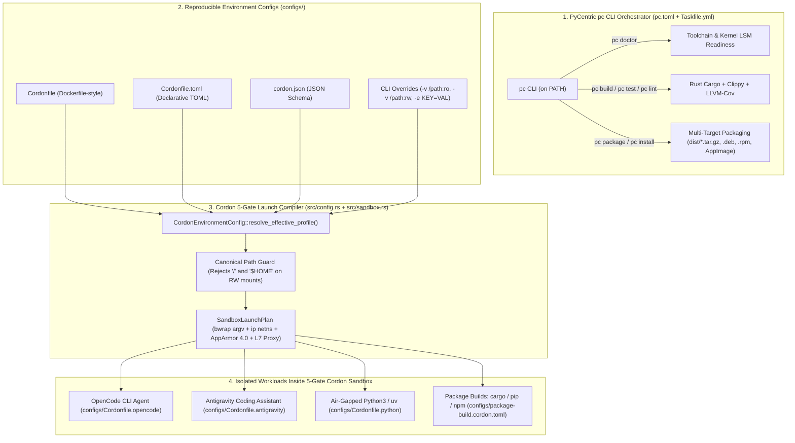
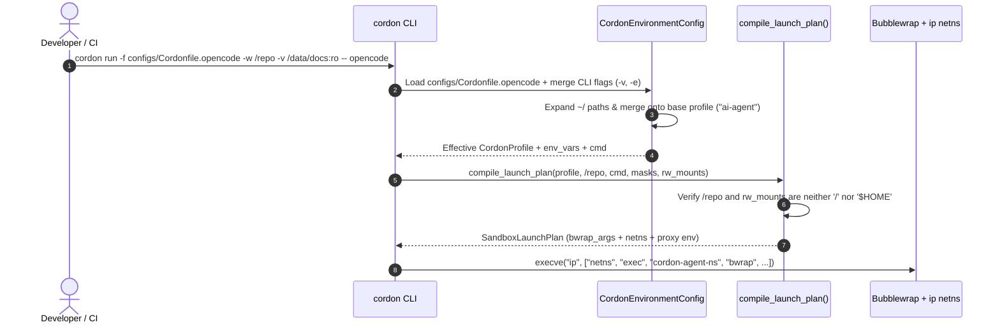
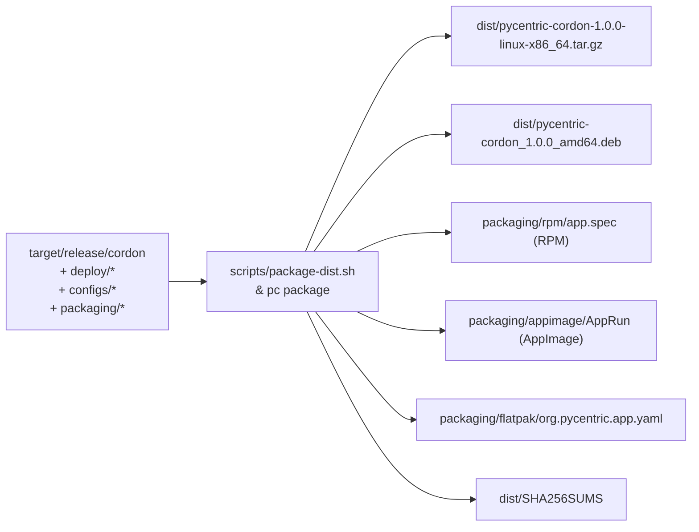

# Cordon Operations, Workload Execution & Packaging Guide

* **Document ID**: `OPS-L0-SEC-02`
* **Governing ADR**: `ADR-L0-SEC-02` (Five-Gate Defense-in-Depth Host Sandbox; internal architecture record, not published)
* **Orchestrator**: PyCentric `pc` CLI (`pc.toml` + `Taskfile.yml`)
* **Version**: `1.0.0`

---

## 1. Architecture & Orchestration Overview

Cordon combines the **PyCentric `pc` CLI Orchestrator** with a **Docker/Podman-inspired reproducible configuration engine (`Cordonfile` / `Cordonfile.toml`)** so engineering teams can build, test, package, and launch 5-gate isolated sandboxes with end-to-end gate overhead inside the canonical `M4` latency budget (defined in `ADR-L0-SEC-02` section 2.1, an internal architecture record that is not published) and zero container daemon overhead.



---

## 2. PyCentric `pc` CLI Orchestrator Reference

Cordon includes a root [`pc.toml`](../pc.toml) manifest that registers the project components (`cordon-core` in Rust and `cordon-flutter-console` in Flutter) with the PyCentric `pc` CLI (installed on `PATH`).

### 2.1 Core `pc` Lifecycle Commands

| `pc` Command | Underlying Action | Purpose |
| :--- | :--- | :--- |
| `pc doctor` | Validates `pc.toml`, Rust, Flutter, `go-task`, and container runtime | Verifies developer workstation readiness |
| `pc build --release` | `go-task build:artifacts` (`cargo build --release --offline`) | Compiles optimized `target/release/cordon` binary |
| `pc lint` | `cargo clippy -- -D warnings`, `flutter analyze` | Enforces zero-warning static analysis across all stacks |
| `pc fmt --check` | `cargo fmt -- --check`, `dart format` | Verifies code formatting without mutating files |
| `pc test --mode fast` | `go-task test:fast` (`cargo test --lib --offline`) | Runs sub-second unit test suite |
| `pc test --mode integration` | `go-task test:integration` | Runs 5-gate sandbox, config, CLI, and HTTP API integration tests |
| `pc test --mode contract` | `go-task test:contract` | Verifies RFC 7807 API contracts and Bash deployment script syntax |
| `pc test --mode stress` | `go-task test:stress` | Runs ignored-marked sandbox hardening stress checks (`tests/cordon_hardening.rs`) |
| `pc test --mode all` | Runs `fast` -> `integration` -> `contract` -> `stress` | Full pre-release verification gate |
| `pc test --coverage` | `cargo llvm-cov` / `flutter test --coverage` | Enforces the `>= 90%` line coverage gate |
| `pc audit` | `cargo deny check` & `cargo audit` | Scans Rust dependency tree for CVEs and licence policy |
| `pc docs --all` | `go-task docs:all` | Builds Rust API docs and runs zero-em-dash constitutional validation |
| `pc dev` | `go-task dev:run` | Starts the `axum` HTTP Control Plane and Web Dashboard on `127.0.0.1:8095` |
| `pc deploy --env staging` | `deploy:preflight` -> `deploy:canary` -> `deploy:verify` -> `deploy:switch` | Validates all `Cordonfile` templates and installs binaries |
| `pc install` | Installs `target/release/cordon` to `/usr/local/bin/cordon` | System-wide binary installation |

---

## 3. Reproducible Environment Configs (`Cordonfile` & `Cordonfile.toml`)

Just as Docker uses `Dockerfile` and Podman uses `Containerfile` to define reproducible container environments, Cordon uses **`Cordonfile`** (directive syntax), **`Cordonfile.toml`** (declarative TOML), and **`cordon.json`** (JSON) to define reproducible **rootless Bubblewrap + network namespace + L7 proxy** environments without container image layers or background daemons.



### 3.1 `Cordonfile` Directive Reference

| Directive | Syntax Example | Description |
| :--- | :--- | :--- |
| `FROM` / `PROFILE` | `FROM ai-agent` | Inherits baseline security gates from one of the 6 built-in profiles (`ai-agent`, `untrusted-code`, `package-build`, `network-audit`, `gui-desktop`, `airgapped`). This list mirrors the README section 2 profile table and [`src/profiles.rs`](../src/profiles.rs). |
| `NAME` | `NAME opencode-agent` | Human-readable environment identifier recorded in audit telemetry |
| `DESCRIPTION` | `DESCRIPTION Reproducible sandbox for OpenCode` | Summary of the environment's security boundary |
| `WORKDIR` | `WORKDIR .` | Default workspace directory bound read-write via `--bind <WORKDIR> <WORKDIR>` |
| `MOUNT` | `MOUNT /data/corpus:ro` or `MOUNT ~/.cache/opencode:rw` | Binds a host folder read-only (`:ro` -> `--ro-bind`) or read-write (`:rw` -> `--bind`) |
| `MASK` | `MASK /usr/bin/docker /usr/bin/podman /usr/bin/ssh` | Overlays host binaries with `/dev/null` (`--ro-bind /dev/null <BIN>`) |
| `MASK_DIR` | `MASK_DIR ~/.ssh ~/.aws ~/.gnupg ~/.kube` | Masks the directory with an empty `tmpfs` overlay inside the sandbox (`--tmpfs <DIR>` at Gate 3): the workload sees an empty directory instead of the host contents and cannot read or modify them. |
| `ALLOW_DOMAIN` | `ALLOW_DOMAIN api.anthropic.com api.openai.com` | Appends domains to the L7 HTTPS proxy allowlist enforced by the running L7 enforcement plane (`mitmdump` addon). |
| `DENY_DOMAIN` | `DENY_DOMAIN pastebin.com transfer.sh ngrok.io` | Appends domains to the L7 HTTPS proxy denylist enforced by the running L7 enforcement plane; matching requests are blocked at Gate 4. |
| `ENV` | `ENV OPENCODE_SANDBOX=cordon` | Injects environment variables into the sandbox via `--setenv KEY VAL` |
| `CMD` | `CMD ["opencode"]` | Default command executed inside the sandbox when none is passed on the CLI |

### 3.2 Managing Templates with `cordon config`

```bash
# 1. List all built-in reproducible workload templates
cordon config list-templates

# 2. Scaffold a new Cordonfile or Cordonfile.toml in your repository
cordon config init --template opencode --format cordonfile --output ./Cordonfile
cordon config init --template antigravity --format toml --output ./Cordonfile.toml

# 3. Validate a Cordonfile or Cordonfile.toml and inspect its resolved profile
cordon config validate --file configs/Cordonfile.opencode
```

---

## 4. Mounting Host Folders Safely (`-v` / `--volume`, `--bind-ro`, `--bind-rw`)

Cordon supports three ways to mount additional host directories into a sandbox:

1. **Docker/Podman-style `-v` / `--volume <HOST_PATH>[:ro|:rw]`**:
   - Defaults to `:ro` (read-only) if the mode suffix is omitted.
   - Expands leading `~/` to `$HOME/`.
   - Example: `-v /opt/shared-datasets:ro -v /tmp/agent-artifacts:rw`
2. **Explicit Read-Only Flag (`--bind-ro <HOST_PATH>`)**:
   - Maps to Bubblewrap `--ro-bind <HOST_PATH> <HOST_PATH>`.
3. **Explicit Read-Write Flag (`--bind-rw <HOST_PATH>`)**:
   - Maps to Bubblewrap `--bind <HOST_PATH> <HOST_PATH>`.

### 4.1 Folder Mounting Security Rules

* **Rule 1 (Never Mount `/` or `$HOME` Read-Write)**: Cordon's `compile_launch_plan()` canonicalizes both the `--workspace` path and every `--bind-rw` / `-v <path>:rw` path. If any writable mount resolves to `/` or `$HOME`, Cordon immediately aborts with `CordonError::UnsafeWorkspaceMount` (`HTTP 422` in the API, exit code `1` in the CLI).
* **Rule 2 (Mount Datasets & Reference Repos Read-Only)**: When an agent or Python script needs to read documentation, shared libraries, or ML datasets outside the current Git repository, mount them with `-v /path/to/dataset:ro`.
* **Rule 3 (Scoped State & Cache Directories)**: When an AI agent (`opencode`, `antigravity`, `claude`) requires persistent configuration or cache directories under `$HOME`, mount only the specific subdirectory read-write (for example, `-v ~/.config/opencode:rw` or `-v ~/.gemini/antigravity/brain:rw`), never `$HOME` itself.

---

## 5. Step-by-Step Workload Recipes

### 5.1 Running `opencode` (OpenCode CLI Agent)

Use [`configs/Cordonfile.opencode`](../configs/Cordonfile.opencode) or [`configs/opencode.cordon.toml`](../configs/opencode.cordon.toml) to run `opencode` inside the 5-gate sandbox:

```bash
# Dry-run to inspect the compiled Bubblewrap + netns launch plan
cordon run -f configs/Cordonfile.opencode \
  -w ~/projects/my-service \
  -v ~/projects/shared-specs:ro \
  -e ANTHROPIC_API_KEY="${ANTHROPIC_API_KEY:-}" \
  --dry-run -- opencode

# Execute opencode inside the sandbox (omit --dry-run on a host with bwrap + netns configured)
cordon run -f configs/Cordonfile.opencode \
  -w ~/projects/my-service \
  -v ~/projects/shared-specs:ro \
  -e ANTHROPIC_API_KEY="${ANTHROPIC_API_KEY:-}" \
  -- opencode
```

**What Cordon enforces for `opencode`**:
- `~/projects/my-service` is bound read-write (`--bind`).
- `~/projects/shared-specs` is bound read-only (`--ro-bind`).
- `~/.config/opencode`, `~/.local/share/opencode`, and `~/.cache/opencode` are bound read-write so session history persists.
- `~/.ssh`, `~/.aws`, `~/.gnupg`, `~/.kube`, `~/.config/gcloud`, and `~/.docker` are replaced with empty `tmpfs` mounts.
- `/usr/bin/docker`, `/usr/bin/podman`, `/usr/bin/virsh`, `/usr/bin/ssh`, `/usr/bin/scp`, and `/usr/bin/nc` are masked with `/dev/null`.
- Outbound HTTPS is routed through `10.200.1.1:8080` (`cordon-agent-ns`), allowing `api.anthropic.com`, `api.openai.com`, `generativelanguage.googleapis.com`, `api.github.com`, `crates.io`, and `pypi.org` while scanning POST payloads for accidentally pasted private keys or cloud tokens.

### 5.2 Running `antigravity` (Google DeepMind Antigravity Agent)

Use [`configs/Cordonfile.antigravity`](../configs/Cordonfile.antigravity) or [`configs/antigravity.cordon.toml`](../configs/antigravity.cordon.toml) to isolate Antigravity tool execution or subagent sessions:

```bash
# Dry-run using the declarative TOML config
cordon run -f configs/antigravity.cordon.toml \
  -w ~/projects/cordon \
  -v ~/.gemini/antigravity/brain:rw \
  -v ~/.gemini/config:ro \
  --dry-run -- bash --norc

# Run a single sandboxed command inside the Antigravity profile
cordon run -f configs/Cordonfile.antigravity \
  -w ~/projects/cordon \
  --dry-run -- cargo test --offline
```

**What Cordon enforces for `antigravity`**:
- Binds the active project workspace and `~/.gemini/antigravity/brain` (artifacts & scratchpad) read-write.
- Binds `~/.gemini/config` (skills & rules) and `~/.gemini/antigravity/mcp` (MCP tool schemas) read-only so the agent can read skills without modifying global rules.
- Masks all host SSH keys, cloud credentials, and container sockets.

### 5.3 Running Untrusted Python Code & `uv` Scripts

Use [`configs/Cordonfile.python`](../configs/Cordonfile.python) or [`configs/python-sandbox.cordon.toml`](../configs/python-sandbox.cordon.toml) (`untrusted-code` base profile) to execute untrusted Python code, LLM-generated scripts, or data-processing jobs with **zero network access (`--unshare-net`)**:

```bash
# 1. Run an untrusted Python script in isolated mode (-I) with a read-only dataset mount
cordon run -f configs/Cordonfile.python \
  -w ~/projects/cordon \
  -v /tmp/input-datasets:ro \
  -v /tmp/output-results:rw \
  --dry-run -- python3 -I scripts/analyze.py

# 2. Run a uv-managed Python script using the cached wheelhouse read-only
cordon run -f configs/python-sandbox.cordon.toml \
  -w ~/projects/cordon \
  -v ~/.cache/uv:ro \
  --dry-run -- uv run --offline pytest
```

**What Cordon enforces for Python / `uv`**:
- **Complete Air-Gap (`NetworkMode::None`)**: Bubblewrap passes `--unshare-net`, creating a loopback-only network namespace with zero external interfaces (`0` egress packets possible).
- **Isolated Python Interpreter (`python3 -I`)**: Sets `PYTHONDONTWRITEBYTECODE=1`, `PYTHONUNBUFFERED=1`, and `PYTHONSAFEPATH=1` to prevent `.pth` or `PYTHONPATH` hijacking.
- **Binary Masking**: Masks `/usr/bin/curl`, `/usr/bin/wget`, `/usr/bin/ssh`, `/usr/bin/nc`, `/usr/bin/socat`, `/usr/bin/docker`, and `/usr/bin/podman`.

### 5.4 Running Isolated Package Builds (`cargo`, `pip`, `npm`)

Use [`configs/package-build.cordon.toml`](../configs/package-build.cordon.toml) to prevent malicious `build.rs`, `setup.py`, or `postinstall` hooks from exfiltrating host secrets during dependency installation:

```bash
cordon run -f configs/package-build.cordon.toml \
  -w ~/projects/cordon \
  --dry-run -- cargo build --release
```

---

## 6. Packaging & Distribution Guide

Cordon provides a multi-target packaging pipeline in [`packaging/`](../packaging) and [`scripts/package-dist.sh`](../scripts/package-dist.sh) integrated with both `go-task` and `pc package`.



### 6.1 Building Redistributable Packages

> **Note**: The web packaging target (`packaging/web/`) is not yet supported. Its Trunk build does not produce a working web entrypoint and its default port overlaps the `cordon serve` HTTP control-plane port (`8095`). Build only the tarball, `.deb`, and `.rpm` targets below until the web target is retargeted.

```bash
# Build all release packages (.tar.gz + .deb + SHA256SUMS) in dist/
go-task package:all

# Or build individual package formats:
go-task package:tarball
go-task package:deb

# Or invoke via the PyCentric pc CLI orchestrator:
pc package deb
pc package rpm
pc package appimage
pc package flatpak
```

### 6.2 Installing Cordon

```bash
# Option A: User-local installation (~/.local/bin/cordon + ~/.config/cordon/configs/ + Bash/Zsh/Fish completions)
go-task install:local

# Option B: System-wide installation via pc CLI (/usr/local/bin/cordon)
pc install

# Option C: Extract and install from the standalone release tarball (includes binaries, configs, and completions)
tar -xzf dist/pycentric-cordon-1.0.0-linux-x86_64.tar.gz
sudo ./stage-pycentric-cordon-1.0.0/install.sh

# Option D: Install the Debian/Ubuntu package (includes /usr/share/{bash-completion,zsh,fish} completions)
sudo dpkg -i dist/pycentric-cordon_1.0.0_amd64.deb
```

---

## 7. Shell Completions (`bash`, `zsh`, `fish`)

Cordon provides native shell completions for **Bash**, **Zsh**, and **Fish** (as well as `elvish` and `powershell`) via `cordon completions <shell>` and pre-packaged static completion scripts in [`packaging/completions/`](../packaging/completions).

### 7.1 What Tab-Completion Covers

* **Subcommands & Flags**: All `cordon` subcommands (`run` / `exec`, `shell`, `repl`, `profiles`, `groups`, `plugin list|info`, `config list-templates|init|validate`, `inspect-cmd`, `render-apparmor`, `render-netns`, `evaluate-url`, `doctor`, `serve`, `tui`, `completions`) and flags (`--profile`, `--config`, `--workspace`, `--volume`, `--bind-ro`, `--bind-rw`, `--mask-bin`, `--env`, `--allow-domain`, `--dry-run`, `--json`).
* **Profile Candidates (`-p` / `--profile`)**: Automatically suggests `ai-agent`, `untrusted-code`, `package-build`, `network-audit`, `gui-desktop`, and `airgapped`.
* **Template & Format Candidates (`cordon config init`)**: Automatically suggests `opencode`, `antigravity`, `python-sandbox`, and `package-build` for `--template`, and `cordonfile`, `toml`, and `json` for `--format`.
* **Wrapper Commands (`agent-sandbox` & `agent-shell`)**: Completion scripts also register completions for the `agent-sandbox` and `agent-shell` wrapper commands.

### 7.2 Quick Install (All Three Shells at Once)

```bash
# Generates and installs Bash, Zsh, and Fish completions into user-local directories:
#   - Bash: ~/.local/share/bash-completion/completions/cordon
#   - Zsh:  ~/.local/share/zsh/site-functions/_cordon and ~/.zfunc/_cordon
#   - Fish: ~/.config/fish/completions/cordon.fish
go-task completions:install
```

### 7.3 Per-Shell Setup Instructions

#### Fish (`~/.config/fish/completions/cordon.fish`)

```fish
# Persistent installation for current user
mkdir -p ~/.config/fish/completions
cordon completions fish --output ~/.config/fish/completions/cordon.fish

# Or evaluate dynamically in ~/.config/fish/config.fish:
cordon completions fish | source
```

#### Zsh (`~/.zfunc/_cordon` or `/usr/share/zsh/site-functions/_cordon`)

```zsh
# Persistent installation for current user
mkdir -p ~/.zfunc
cordon completions zsh --output ~/.zfunc/_cordon

# Ensure ~/.zfunc is in your fpath before compinit in ~/.zshrc:
#   fpath=(~/.zfunc $fpath)
#   autoload -Uz compinit && compinit

# Or evaluate dynamically in ~/.zshrc:
source <(cordon completions zsh)
```

#### Bash (`~/.local/share/bash-completion/completions/cordon`)

```bash
# Persistent installation for current user (loaded automatically by bash-completion)
mkdir -p ~/.local/share/bash-completion/completions
cordon completions bash --output ~/.local/share/bash-completion/completions/cordon

# Or evaluate dynamically in ~/.bashrc:
eval "$(cordon completions bash)"
```

---

## 8. Quick Command Execution, Network Namespace Auto-Fallback & Interactive REPL (`cordon repl`)

### 8.1 Running Commands Quickly (Zero-Setup Rootless Execution)

When `cordon run` (or `cordon exec`) is invoked on a workstation where `sudo deploy/net/setup-sandbox-net.sh` has not yet provisioned `/run/netns/agent-net` (or when running unprivileged without `CAP_SYS_ADMIN`), [`prepare_live_execution_argv`](../src/sandbox.rs) automatically detects that `agent-net` is unavailable and falls back to **direct Bubblewrap execution** (Gates 2, 3, and 4 active, masking `~/.ssh`, `~/.aws`, `~/.gnupg`, `~/.kube`, and `~/.config/gcloud` with empty `tmpfs` mounts while binding `~/.config/opencode` and `~/.local/share/opencode` read-write).

```bash
# 1. Run opencode immediately inside the current project folder (no '--' required)
cordon run opencode

# 2. Alias 'cordon exec' works identically
cordon exec opencode

# 3. Force complete offline air-gap (bwrap --unshare-net) for any command
cordon run --offline python3 -I script.py

# 4. Drop directly into an interactive sandboxed bash shell
cordon shell
cordon shell --offline
```

### 8.2 Interactive Sandbox Control & Execution REPL (`cordon repl`)

Cordon includes a built-in interactive REPL ([`src/repl.rs`](../src/repl.rs)) that maintains live session state (active profile, loaded `Cordonfile`, workspace directory, volume mounts, environment variables, L7 allowed domains, and network mode) so you can inspect plans, test URLs against Gate 5, and execute multiple sandboxed commands without retyping flags:

```bash
# Start the interactive Cordon REPL
cordon repl

# Example session inside cordon repl:
cordon[ai-agent|net:auto|.]$ status
cordon[ai-agent|net:auto|.]$ load configs/Cordonfile.opencode
cordon[ai-agent|net:auto|.]$ mount /tmp:rw
cordon[ai-agent|net:auto|.]$ net airgap
cordon[ai-agent|net:airgap|.]$ eval https://api.openai.com/v1/chat/completions POST sk-1234567890abcdefghijklmnop
cordon[ai-agent|net:airgap|.]$ plan opencode
cordon[ai-agent|net:airgap|.]$ !python3 -V
cordon[ai-agent|net:airgap|.]$ run opencode
cordon[ai-agent|net:airgap|.]$ shell
cordon[ai-agent|net:airgap|.]$ exit
```

---

## 9. Headless L7 Enforcement Plane, DNS & Audit Telemetry Operations

* **Headless `cordon l7-proxy` (`cordon-l7.service`)**: Gate 4 L7 inspection runs headless `cordon l7-proxy` under `systemd` as `cordon-l7.service`, loading `/run/cordon/policy.json` (root-owned `0644`). `ALLOW_DOMAIN` and `DENY_DOMAIN` directives are wired into this running L7 enforcement plane, so config changes take effect against live traffic evaluation.
* **Audit Telemetry**: the service writes structured JSONL audit events to `/var/log/cordon/audit.jsonl` with `0640` permissions (auditor-group readable, never world-readable).
* **DNS Resolution**: sandboxed DNS queries are DNATed at Gate 1 to the host-local resolver at `10.200.1.1:53`, with optional `dnsmasq` query logging on the host for DNS-level telemetry.
* **PCAP Ring Buffer**: Gate 5 `tshark` captures on `veth-host` with a bounded rotating ring (`-b filesize:102400 -b files:10`), capping the forensic PCAP footprint at approximately 1 GB.


