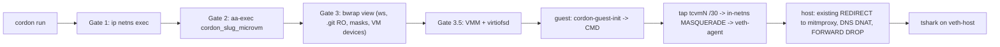

# MicroVM Isolation Plane (Gate 3.5): Design

> Status: in progress. The compile-time plane (domain model, config, plan compiler, CLI/API,
> doctor) lands first; the guest agent, live launch, and snapshots (sections 7-9) follow.

**Licence:** AGPL-3.0-only (open core). Firecracker (Apache-2.0), QEMU (GPL-2.0), virtiofsd (Apache-2.0/BSD) and libkrun (Apache-2.0) are only ever **invoked as external binaries**. Nothing is linked or vendored.

---

## 1. Motivation

Bubblewrap shares the host kernel. A kernel exploit reachable through the syscall surface (for example `io_uring` or netfilter) escapes Gates 2 and 3. An optional **Gate 3.5** runs the workload under a dedicated guest kernel behind hardware virtualisation (`/dev/kvm`).

A MicroVM alone is not a complete perimeter either: it does not filter egress and does not protect the workspace it shares. So the VMM runs **inside** Gates 1-3, and its traffic passes through the existing L7 and PCAP gates unchanged.

Workload fit:
- **untrusted-code / network-audit:** sealed block-device VM (Firecracker), optional warm snapshot restore.
- **ai-agent / package-build:** live workspace VM (QEMU `microvm` + virtiofsd).

Non-goals for v1: GUI/GPU passthrough, nested virtualisation, macOS/Windows hosts, writing guest output back for sealed VMs (follow-up), snapshot restore on QEMU.

## 2. Pipeline



Rule: **the host-side Gate 4/5 rules do not change.** Guest traffic is masqueraded to `sandbox_veth_ip` inside the netns, so to the host it looks exactly like a native sandboxed process.

## 3. Network topology

The veth pair keeps `10.200.1.0/24` (`host .1`, `sandbox .2`). Guests get a **separate tap pool** inside the netns, one `/30` per slot, carved from `10.200.255.0/24`:

| Slot | Tap | Netns side | Guest |
|---|---|---|---|
| 0 | `tcvm0` | `10.200.255.1/30` | `10.200.255.2` |
| 1 | `tcvm1` | `10.200.255.5/30` | `10.200.255.6` |
| n | `tcvm<n>` | `10.200.255.(4n+1)/30` | `10.200.255.(4n+2)` |

The pool size defaults to 4 and the maximum is 16. `deploy/net/setup-sandbox-net.sh` provisions it (as root, once), and `network.rs` (`generate_microvm_tap_commands`) renders the same commands:

```bash
ip netns exec $NS ip tuntap add dev tcvm$N mode tap user $UID     # persistent, opened without CAP_NET_ADMIN
ip netns exec $NS ip addr replace 10.200.255.$((4*N+1))/30 dev tcvm$N
ip netns exec $NS ip link set tcvm$N up
ip netns exec $NS sysctl -w net.ipv4.ip_forward=1
ip netns exec $NS iptables -t nat -A POSTROUTING -s 10.200.255.0/24 -o veth-agent -j MASQUERADE
ip netns exec $NS iptables -A FORWARD -i tcvm+ -o veth-agent -j ACCEPT
ip netns exec $NS iptables -A FORWARD -i veth-agent -o tcvm+ -m conntrack --ctstate RELATED,ESTABLISHED -j ACCEPT
ip netns exec $NS iptables -A FORWARD -j DROP                     # includes guest-to-guest (tap to tap)
ip netns exec $NS iptables -A INPUT -i tcvm+ -j DROP              # guest cannot reach netns-local services
ip netns exec $NS ip6tables -A FORWARD -j DROP                    # IPv6 is already sysctl-disabled; belt and braces
```

All commands are idempotent (`-C || -A`), matching the existing style. Each run takes a slot with an exclusive `flock` on `/run/cordon/tap/<n>.lock`. If all slots are busy, the run fails with `MicroVmUnavailable` and never shares a tap.

The guest resolver is `host_veth_ip`. The host DNS DNAT catches port 53 regardless of destination, as it does today.

**Fail-closed:** if the netns or the tap pool is missing, the live adapter already falls back to `--unshare-net`. The VM then boots **with no NIC** (loopback only) and the fallback notice says so. A VM never gets a host-network tap.

**NetworkMode interaction:** `Inspected` and `AllowlistOnly` give the guest a NIC on a tap. `None` gives no NIC. `Direct` combined with any VM backend is rejected (`UnsupportedVmOption`): a host-netns tap needs root and bypasses Gates 4 and 5.

## 4. Engines

| Backend (wire name) | Status v1 | Disk modes | Kernel | Control channel |
|---|---|---|---|---|
| `native-bwrap` | default, unchanged | n/a | host | n/a |
| `qemu-microvm` | supported | `virtio-fs-live`, `ephemeral-tmpfs`, `btrfs-cow-overlay` | required, MicroVM config | virtio-serial port over a Unix socket |
| `firecracker` | supported | `ephemeral-tmpfs`, `btrfs-cow-overlay`, `snapshot-restore` | required, uncompressed `vmlinux` | hybrid vsock over a Unix socket |
| `krun` | **reserved** | `virtio-fs-live` | bundled (libkrunfw), `kernel_image` rejected | launcher-defined |

`krun` is accepted by the schema, but compiling it returns `UnsupportedVmOption("krun launcher not selected")` until a launcher is chosen (`krunvm` is not suitable: it builds VMs from OCI images through buildah). If enabled later, libkrun's TSI networking is still confined by Gate 1, because its sockets originate from the VMM process inside the netns.

### 4.1 Guest kernel

Distro kernels usually build virtiofs and virtio-mmio as modules, so they cannot mount a virtiofs root without an initramfs. Cordon ships `deploy/microvm/kernel.config` as a config fragment with these options built in (`=y`): `VIRTIO_MMIO`, `VIRTIO_BLK`, `VIRTIO_NET`, `VIRTIO_CONSOLE`, `VIRTIO_VSOCKETS`, `FUSE_FS`, `VIRTIO_FS`, `EROFS_FS`, `EXT4_FS`, `OVERLAY_FS`, `VIRTIO_RNG`, `VMGENID`. Using a host `/boot/vmlinuz-*` is allowed but not guaranteed to work. `doctor` reports this as a warning, not a failure.

## 5. Domain model

```rust
#[derive(Debug, Clone, Copy, PartialEq, Eq, Serialize, Deserialize, Default, ValueEnum)]
pub enum IsolationBackend {
    #[default]
    #[serde(rename = "native-bwrap")] #[value(name = "native-bwrap")] NativeBwrap,
    #[serde(rename = "qemu-microvm")] #[value(name = "qemu-microvm")] QemuMicrovm,
    #[serde(rename = "firecracker")]  #[value(name = "firecracker")]  Firecracker,
    #[serde(rename = "krun")]         #[value(name = "krun")]         Krun,
}

#[derive(Debug, Clone, Copy, PartialEq, Eq, Serialize, Deserialize, ValueEnum)]
#[serde(rename_all = "kebab-case")]
pub enum VmDiskMode { VirtioFsLive, EphemeralTmpfs, BtrfsCowOverlay, SnapshotRestore }

/// Units are explicit in field names (MiB/s for disk, Mbit/s for network).
pub struct VmRateLimits {
    pub disk_iops: Option<NonZeroU32>,
    pub disk_bandwidth_mib_s: Option<NonZeroU32>,
    pub net_bandwidth_mbit_s: Option<NonZeroU32>,
}

/// Fields are private: the only constructor is `TryFrom<RawMicroVmSpec>`, which serde uses via
/// `#[serde(try_from = "RawMicroVmSpec", into = "RawMicroVmSpec")]`, so an invalid spec cannot exist.
pub struct MicroVmSpec {
    backend: IsolationBackend,
    vcpus: NonZeroU8,              // 1..=32
    memory_mib: NonZeroU32,        // 128..=65536
    disk_mode: VmDiskMode,
    kernel_image: Option<VmImagePath>,
    rootfs_image: Option<VmImagePath>,
    snapshot: Option<SnapshotName>, // slug, resolved to /var/lib/cordon/snapshots/<name>/
    rate_limits: Option<VmRateLimits>,
}
```

Design choices:
- `vsock_cid` is **removed**.
- `snapshot_mem` and `snapshot_state` are replaced by a validated snapshot **name**, so the user never supplies raw memory-dump paths.
- `enabled` is removed: `backend = "native-bwrap"` (the default) means no VM, which leaves one less invalid state.

`VmImagePath` is a newtype over `CanonicalPath`.

`SandboxLaunchPlan` gains `#[serde(default, skip_serializing_if = "Option::is_none")] pub microvm: Option<MicroVmExecutionPlan>`. Existing plan JSON stays byte-identical.

## 6. Validation invariants

| Id | Rule | Error (HTTP) |
|---|---|---|
| VM-INV-1 | Backend x disk mode must be in the section 4 matrix | `IncompatibleVmDiskMode` (422) |
| VM-INV-2 | Image paths: absolute, no `..`, **under an allowlisted image root** (kernels: `/boot`, `/var/lib/cordon/kernels`, `/usr/{lib,share}/cordon/kernels`, `~/.local/share/cordon/kernels`; rootfs: `/var/lib/cordon/images`, `/usr/{lib,share}/cordon/images`, `~/.local/share/cordon/images`), **no symlink in any existing component**, regular file when present. An allowlist (not a denylist) prevents attaching arbitrary user-readable files, such as private keys, to the guest as raw disks | `UnsafeMicroVmImage` (422) |
| VM-INV-3 | `qemu-microvm` and `firecracker` require `kernel_image`. Block modes require `rootfs_image`. `btrfs-cow-overlay` requires an ext4 rootfs. `krun` forbids `kernel_image` | `InvalidInput` (400) |
| VM-INV-4 | Any VM backend with `NetworkMode::Direct`, or with a profile that has `allow_gui_wayland`, `allow_x11` or `allow_gpu_dri` set | `UnsupportedVmOption` (422) |
| VM-INV-5 | `net_bandwidth_mbit_s` on `qemu-microvm` (no per-run tap shaping without root), or disk limits with `virtio-fs-live` | `UnsupportedVmOption` (422) |
| VM-INV-6 | `virtio-fs-live`: the EC-01 binds (`.git`, `.git/hooks`, `.husky` RO) appear in the bwrap argv **before** the VMM and virtiofsd exec | compile-time test |
| VM-INV-7 | `/dev/kvm`, `/dev/net/tun` and the `_microvm` AppArmor profile appear **only** in plans where `microvm.is_some()` | compile-time test |
| VM-INV-8 | `NetworkMode::Inspected` / `AllowlistOnly`: the guest receives the CA bundle and the full CA env set already used natively (`SSL_CERT_FILE`, `REQUESTS_CA_BUNDLE`, `NODE_EXTRA_CA_CERTS`, `CURL_CA_BUNDLE`, `DENO_CERT`, plus `CARGO_HTTP_CAINFO`) | compile-time test |

All new errors return stable, path-free `detail` strings, consistent with `stable_client_detail`. `MicroVmUnavailable` (KVM missing, tap pool exhausted, VMM binary absent) is a runtime error: exit code 69 (`EX_UNAVAILABLE`) on the CLI, 503 if it ever surfaces through the API.

## 7. Guest agent: `cordon-guest-init`

This is a new workspace crate (`crates/cordon-guest-init`): Rust, static musl binary, `#![forbid(unsafe_code)]`, no network listeners. It runs as PID 1 and does the following:

1. Mounts `proc`, `sys`, `dev`, and a tmpfs on `/run` and `/tmp`.
2. Sets up the root:
   - `virtio-fs-live`: the virtiofs root is the bwrap view, so the host's masks, `.git` RO binds and CA overlays are already in place.
   - Block modes: an overlayfs with the erofs/ext4 base as lower and a tmpfs (`ephemeral-tmpfs`) or the reflinked disk (`btrfs-cow-overlay`) as upper. The workspace image is mounted read-only at its canonical path.
3. Signals `ready` and waits for one **ExecEnvelope** on the control channel.
4. Configures `eth0` and `/etc/resolv.conf` from the envelope, writes the envelope's entropy to `/dev/urandom`, applies `env`, `cwd` and `uid/gid`, then `exec`s the command with **stdio bound to the guest console**, so TUIs such as `opencode` work over the VMM's stdio.
5. Reports `exit` with the status code. The guest then powers off (`reboot=t panic=-1`).

**Wire protocol:** frames are a `u32` big-endian length followed by UTF-8 JSON, at most 1 MiB, with a versioned schema. Golden fixtures live in `tests/golden/microvm_envelope.json` and are shared with Python.

```json
{"v":1,"argv":["python3","-I","analyze.py"],"cwd":"/home/u/sample","uid":1000,"gid":1000,
 "env":{"SSL_CERT_FILE":"/etc/ssl/certs/ca-certificates.crt"},
 "net":{"addr":"10.200.255.2/30","gw":"10.200.255.1","dns":"10.200.1.1"},
 "entropy_b64":"<64 random bytes>","tty":true}
```
Guest to host: `{"v":1,"event":"ready"}`, then `{"v":1,"event":"exit","code":0}` or `{"v":1,"event":"error","reason":"..."}`.

**Control transport: a Unix socket on the host for both engines.**
- **Firecracker:** hybrid vsock UDS. The host writes `CONNECT 1024\n`; the guest listens on vsock port 1024.
- **QEMU:** `virtserialport name=org.cordon.ctl` backed by `-chardev socket,path=...`. There is no vhost-vsock, so no host-global CID and no `/dev/vhost-vsock`.

All VMM sockets live in `/tmp/cordon-vm/` on the Bubblewrap `/tmp` tmpfs: private to the sandbox, never on the host filesystem, and at a fixed path, which snapshots need.

Known limitation: terminal resize (SIGWINCH) is not propagated in v1. The follow-up is a `resize` frame.

## 8. Launch plans (Gate 3.5)

Inside the bwrap tail, the plan runs a small Cordon supervisor subcommand (`cordon __vm-supervise <plan.json>`). It starts virtiofsd (if needed) and the VMM, drives the Firecracker API or the control socket, sends the envelope, and returns the guest exit code. The supervisor inherits Gates 1-3 and the `_microvm` AppArmor profile.

**QEMU (`virtio-fs-live`), representative argv:**
```
virtiofsd --socket-path=/tmp/cordon-vm/fs.sock --shared-dir=/ --sandbox=none --cache=auto --announce-submounts
qemu-system-x86_64 -M microvm,x-option-roms=off,pit=off,pic=off,isa-serial=on,rtc=off
  -enable-kvm -cpu host -smp <vcpus> -m <mib> -nodefaults -no-user-config -nographic -no-reboot
  -object memory-backend-memfd,id=mem,size=<mib>M,share=on -numa node,memdev=mem
  -kernel <kernel> -append "console=ttyS0 quiet reboot=t panic=-1 rootfstype=virtiofs root=cordonroot init=/cordon-guest-init"
  -chardev socket,id=fs0,path=/tmp/cordon-vm/fs.sock -device vhost-user-fs-device,chardev=fs0,tag=cordonroot
  -netdev tap,id=n0,ifname=tcvm<N>,script=no,downscript=no -device virtio-net-device,netdev=n0   # omitted when fail-closed
  -device virtio-serial-device -chardev socket,id=ctl,path=/tmp/cordon-vm/ctl.sock,server=on,wait=off
  -device virtserialport,chardev=ctl,name=org.cordon.ctl -serial stdio
```
virtiofsd uses `--sandbox=none` because bwrap already provides the namespaces and nested userns may be blocked. It exports `/` **as seen inside bwrap**, so the guest gets the same filesystem policy as a native run. A guest-root write to `.git/hooks` fails with `EROFS` (TV-VM-01). `cordon-guest-init` itself comes from a read-only bind of the installed binary.

**Firecracker:** the supervisor runs `firecracker --api-sock /tmp/cordon-vm/api.sock --level Warning`, then calls `PUT /machine-config`, `/boot-source`, `/drives/rootfs` (RO base), `/drives/overlay` (when `btrfs-cow-overlay`), `/drives/workspace` (RO packed image), `/network-interfaces/eth0` (`host_dev_name: tcvm<N>`, omitted when fail-closed), `/vsock` (`uds_path`), `/entropy`, and finally `PUT /actions {"action_type":"InstanceStart"}`. Rate limits map to token buckets with explicit units:

| Field | Firecracker bucket |
|---|---|
| `disk_bandwidth_mib_s = B` | `bandwidth: {size: B*1048576, refill_time: 1000}` |
| `disk_iops = I` | `ops: {size: I, refill_time: 1000}` |
| `net_bandwidth_mbit_s = M` | `bandwidth: {size: M*125000, refill_time: 1000}` on rx and tx |

**Sealed workspace (block modes):** inside Gate 3, the workspace is packed into a read-only image at `/tmp/cordon-vm/workspace.img` with `mkfs.erofs`, or `mke2fs -d` when that is not installed. Size is capped (default 2 GiB, `--vm-workspace-cap`), and the image is always padded to the cap so its virtio-blk capacity is constant, which snapshot restore requires. The image is deleted on exit. Output write-back is out of scope for v1.

**No `jailer`:** bwrap, AppArmor and Firecracker's built-in seccomp filters cover its role. cgroup v2 CPU and memory caps are a follow-up.

## 9. Snapshots (Firecracker only)

- `cordon vm snapshot create --name <slug> -f Cordonfile.toml` boots a **fresh** VM to `ready` (no workload ever runs), sends `PATCH /vm {"state":"Paused"}`, then `PUT /snapshot/create`. It writes `/var/lib/cordon/snapshots/<slug>/{vm.snap, vm.mem, manifest.json}` with mode `0600`. The manifest records the sha256 of the kernel and rootfs, the Firecracker version, vcpus/memory, and the tap-less, path-stable device layout.
- `cordon run ... --vm-snapshot <slug> -- cmd` (or `cordon vm snapshot restore --name <slug> -- cmd`) verifies the manifest and rejects any mismatch with the current binaries or images. It then runs `PUT /snapshot/load` with `resume_vm: true` and sends the envelope. The guest NIC is configured **after** restore from the envelope, so the snapshot is not tied to one tap slot. Rebinding a tap at restore time depends on the installed Firecracker's snapshot-load network override support. `doctor` reports the version, and PR 6 confirms the minimum supported version.
- **Clone safety:** every restore of the same snapshot starts with identical guest RNG state. This is mitigated by `VMGENID` (the guest kernel reseeds) plus the per-run `entropy_b64` in the envelope. Snapshots never go into the workspace.

## 10. Configuration, CLI, API, doctor

**Cordonfile.toml**
```toml
profile = "untrusted-code"
[vm]
backend = "firecracker"           # native-bwrap | qemu-microvm | firecracker | krun
vcpus = 2
memory_mib = 1024
disk_mode = "ephemeral-tmpfs"
kernel_image = "/var/lib/cordon/kernels/vmlinux-microvm"
rootfs_image = "/var/lib/cordon/images/alpine-audit.erofs"
# snapshot = "python-warm"        # only with disk_mode = "snapshot-restore"
[vm.rate_limits]
disk_iops = 5000
disk_bandwidth_mib_s = 250
net_bandwidth_mbit_s = 100
```

**Cordonfile**
```
VM_BACKEND firecracker
VM_RESOURCES vcpus=2 memory_mib=1024 disk_mode=ephemeral-tmpfs
VM_KERNEL /var/lib/cordon/kernels/vmlinux-microvm
VM_ROOTFS /var/lib/cordon/images/alpine-audit.erofs
VM_RATE_LIMIT disk_iops=5000 disk_mib_s=250 net_mbit_s=100
VM_SNAPSHOT python-warm
```
Unknown keys are errors, never silently ignored. Both formats round-trip through `to_toml_string` and `to_cordonfile_string`.

**CLI:** `--vm-backend`, `--vm-vcpus`, `--vm-memory`, `--vm-disk-mode`, `--vm-kernel`, `--vm-rootfs`, `--vm-snapshot`, `--vm-workspace-cap`. Subcommands: `cordon vm snapshot {create,restore,list,rm}` and `cordon render-apparmor -p <slug> --microvm`. CLI flags override Cordonfile values. `--dry-run` prints the full plan, including the VMM argv and the Firecracker API sequence.

**API:** `POST /api/v1/compile` and `POST /api/v1/compile-config` accept an optional `vm` object and return `microvm` in the plan. All existing request and response shapes are unchanged.

**doctor (11 -> 15 checks, all `required: false`, so `healthy` is unchanged):**

| Check | Passes when |
|---|---|
| `kvm_device_accessible` | `/dev/kvm` exists and is readable and writable by the current user |
| `tun_device_accessible` | `/dev/net/tun` exists, and the `tcvm*` pool is present in the netns when running as root |
| `microvm_vmm_binaries` | Detail lists the paths of `firecracker`, `qemu-system-x86_64` and `virtiofsd`. Passes if at least one engine is complete (Firecracker, or QEMU plus virtiofsd) |
| `btrfs_reflink_support` | `/var/lib/cordon` (or its nearest existing ancestor) is on Btrfs, read from `/proc/self/mountinfo` without writing anything |

`/dev/vhost-vsock` is no longer checked. README, QUICKSTART and CHANGELOG move from "11-point" to "15-point".

## 11. AppArmor

`render_apparmor_profile` gains a `microvm: bool` variant rendered as **`cordon_<slug>_microvm`**. On top of the base profile it adds:
```
/dev/kvm rw,
/dev/net/tun rw,
/var/lib/cordon/run/** rwk,
/var/lib/cordon/snapshots/** rwk,
```
Kernel and rootfs images are covered by the base `/** r` rule, and the runtime sockets by the base `/tmp/** rwkl` rule.
The base (non-VM) profiles gain an explicit `deny /dev/kvm rw,`. The existing `deny capability net_admin` / `sys_admin` stay. A persistent user-owned tap needs neither. Entry validation and the fail-closed deny-all fallback still apply.

## 12. Tests

**Fast (unit, no KVM):**
- the full 4 x 4 backend/disk-mode matrix
- golden wire names (`tests/golden/microvm_spec_cases.json`)
- VM-INV-2 path cases: symlinked parent, `/dev/sda`, `/etc/shadow`, `~/.ssh/x`, `..` traversal, wrong root for kind
- VM-INV-4 and VM-INV-5 rejections
- EC-01 binds ordered before the VMM exec
- no KVM devices or `_microvm` profile in non-VM plans
- rate-limit unit conversion
- envelope framing: max size, truncated frame, bad version
- tap slot address arithmetic
- fail-closed plan has no `virtio-net` and no `/network-interfaces`

Coverage stays >= 90%, with zero `unwrap_used` / `expect_used`.

**Contract:** deterministic JSON contract across all four backends (`/api/v1/compile`), RFC 7807 error payloads, and envelope fixtures (`tests/golden/microvm_spec_cases.json`).

**Integration (`#[ignore]`, needs `/dev/kvm`, VMM binaries and a provisioned netns):**

| Id | Scenario | Expected |
|---|---|---|
| TV-VM-01 | Guest root runs `echo x > $WS/.git/hooks/pre-commit` (qemu-microvm, virtio-fs-live) | `EROFS` |
| TV-VM-02 | Guest POSTs a synthetic `sk-...` / `github_pat_...` (firecracker, Inspected) | Gate 4 L7 proxy 403 plus an audit event |
| TV-VM-03 | Snapshot restore to `ready`; qemu-microvm cold boot | < 35 ms / < 200 ms (benchmark, reported not gated) |
| TV-VM-04 | Guest raw TCP 9999 egress | dropped (host FORWARD DROP) |
| TV-VM-05 | Guest UDP 443 (QUIC) | rejected |
| TV-VM-06 | Netns absent | guest has only `lo`; fallback notice printed |
| TV-VM-07 | Native `cordon_<slug>` profile opens `/dev/kvm` | denied |
| TV-VM-08 | Restore after the rootfs changes | manifest mismatch error |
| TV-VM-09 | Two concurrent VMs | distinct tap slots; guest-to-guest traffic dropped |

## 13. Rationale summary

| Decision | Reason |
|---|---|
| Separate tap pool (`10.200.255.0/24`) with in-netns MASQUERADE | The veth pair already owns `10.200.1.0/24`; masquerading keeps the host Gate 4/5 rules unchanged |
| `cordon-guest-init` with a framed JSON envelope | Command execution and CA/env injection need a defined in-guest agent |
| `krun` reserved | `krunvm` builds VMs from OCI images; libkrun bundles its kernel and uses TSI networking |
| Unix-socket control channel, no `vsock_cid` | vhost-vsock CIDs are host-global; Firecracker uses hybrid vsock over a Unix socket anyway |
| Explicit wire names | `qemu-microvm` / `krun` must match across JSON, TOML, and CLI |
| Explicit units (`_mib_s`, `_mbit_s`) | `mbps` is ambiguous between MB/s and Mbit/s |
| Stdio on the guest console | Interactive TUIs (coding agents) need a terminal |
| VMGENID, per-run entropy, fresh-boot-only `0600` snapshots | Snapshot clones would otherwise share RNG state and could carry secrets |
| `Direct` + MicroVM rejected | A host-netns tap would bypass Gates 4-5 |
| Latency figures are targets | Benchmarks are reported, not CI-gated |

## 14. Delivery

1. Domain model, validation, and this document.
2. Config (`[vm]` TOML table and `VM_*` Cordonfile directives).
3. Plan compiler plus sandbox, AppArmor, and network integration (dry-run).
4. CLI, API, doctor, and Python parity.
5. `cordon-guest-init`, supervisor, and live QEMU/Firecracker launch.
6. Snapshots, reflink overlays, and benchmarks.
